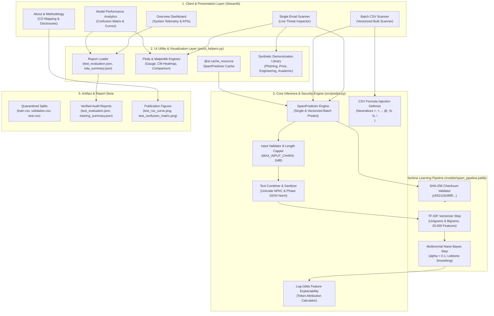
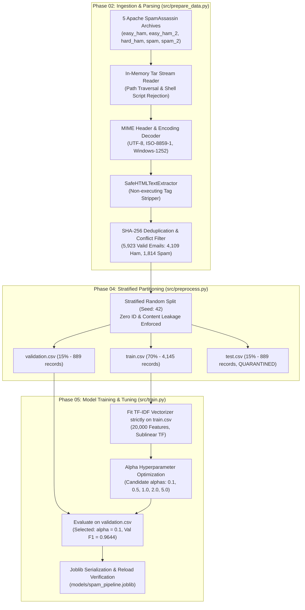
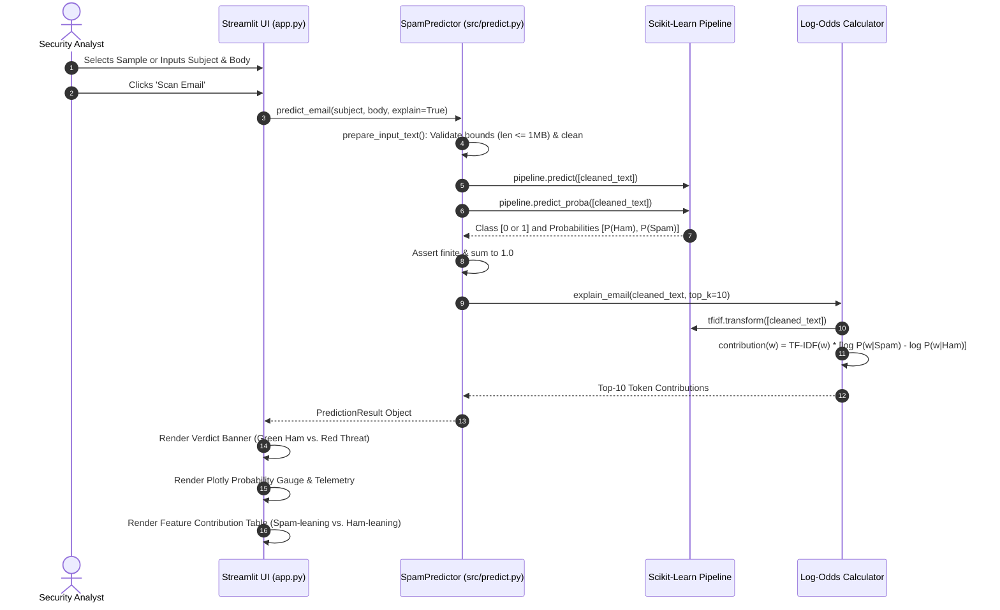
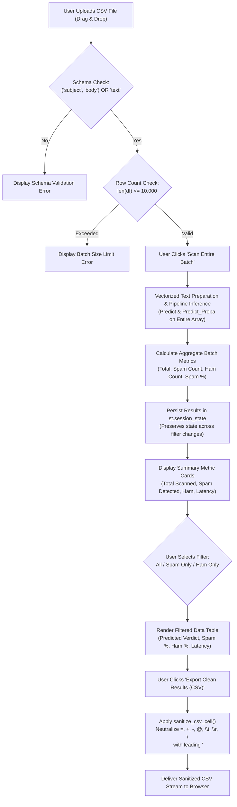
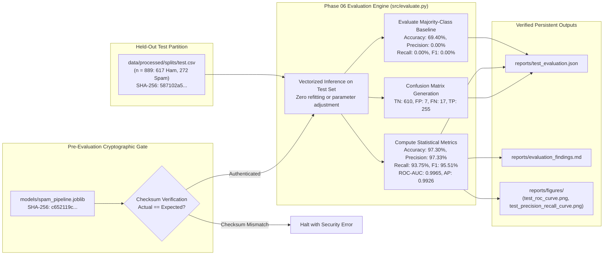

# SpamGuard AI — System Architecture & Workflow Specifications

> **Academic AI Micro Project – 05** | **Domain:** Cybersecurity / Email Threat Filtering  
> **Course Outcomes:** CO2 (Algorithm Selection), CO4 (Model Engineering), CO5 (Evaluation Metrics)  
> **Status:** Phase 10 Final Release Architecture Specification

---

## 1. Overall System Architecture

The following diagram illustrates the multi-tier architectural layout of SpamGuard AI, separating the presentation layer, the modular inference engine, the persistence and artifact stores, and defensive security boundaries.

---

## 2. Dataset Preparation & Training Pipeline

This flowchart documents the complete Phase 02 to Phase 05 pipeline, illustrating how raw archives are converted into the frozen classifier without data leakage.

---

## 3. Single Email Prediction Workflow

The single email workflow illustrates the life-cycle of a user request from text entry to token-level explainability.

---

## 4. Batch Email Classification Workflow

The batch workflow handles high-throughput vectorized classification with spreadsheet formula injection defenses.

---

## 5. Model Evaluation Workflow (Phase 06)

This specification details the independent evaluation pipeline strictly assessing the frozen model on the held-out test partition.

